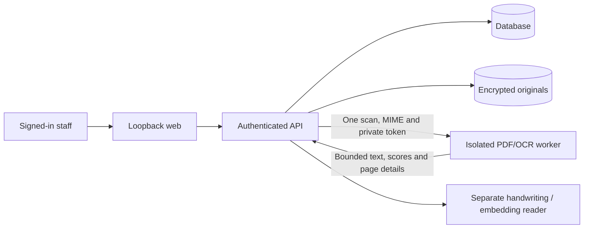

# PDF/OCR parser isolation — November 3, 2026

Native printed-text processing now runs in a dedicated local `ocr` service.
**This limits a parser compromise; it does not fix native-library vulnerabilities
or approve real-patient/LAN release.** Earlier Phase 8 diagrams and raw scanner
counts are historical; SECURITY_FOLLOWUP.md remains the vendor-applicability review.

Current vendor updates and dated scan results are in
[SECURITY_REFRESH_2026-11-06.md](SECURITY_REFRESH_2026-11-06.md). The isolation
boundary remains unchanged; the security refresh is not a waiver of native findings.

## Boundary and data flow



- API authenticates staff, verifies upload ownership and original-file integrity,
  decrypts that scan, and sends its bytes to the worker. It sends no patient object,
  file ID/path, database credentials, original-file key or model credential.
- Worker has a distinct private token, only the internal `ocr_link` network, no
  published port, no database/file/model mounts and no data-store credentials or
  libraries. Database, web and model reader do not join its network. Only API
  bridges the OCR link to the existing backend network. Actual TCP connection to
  the database was checked and denied from the worker.
- Root filesystem is read-only; worker is nonroot, drops all capabilities and
  forbids new privileges. It has a private PID/IPC namespace, 1 GiB memory, two CPU
  cores, 64-process limit and a 256 MiB noexec/nosuid temporary memory filesystem.
- It processes one scan at a time with bounded connection threads, a 20 MiB input
  limit, strict MIME/signature/length checks and no chunked uploads. Authentication
  precedes reading/parsing the body; request contents/tokens are not logged.
- Each job uses a resource-limited child process and private temporary directory.
  Native processing retains the 90-second overall timeout, ten-page limit and
  encrypted/invalid PDF rejection. Temporary plaintext is removed on normal/error/
  timeout paths and never stored on a patient-data volume.
- API image contains neither pdfinfo/pdftoppm/tesseract nor native-worker Python
  modules. There is **no in-process native fallback**. Patient matching, conservative
  field extraction, provenance, auditing and persistence stay in the API.
- API refuses unexpected response fields, invalid/nonfinite scores, bad page
  details, malformed Unicode/JSON, compression, redirects and oversized responses.
  Reads are bounded to 1 MiB; connection failure is bounded separately from parsing.
  OCR remains advisory; even a valid response does not approve clinical information.

A compromised worker can still affect its own processing, current/future scans and
availability, and has network access to the API's authenticated HTTP interface.
Isolation assumes the container/host boundary holds. It does not make native parsing
safe against every flaw or replace patching, independent review or staff verification.

## Setup and operation

For an existing installation, run once before rebuilding:

```powershell
.venv/Scripts/python.exe scripts/configure-ocr.py
docker compose --profile semantic up --build -d
```

The configuration script adds only `OCR_TOKEN`, preserves existing keys/settings,
refuses duplicate/invalid existing credentials and never prints the token. New
`scripts/create-env.py` installations generate the token automatically. Do not
replace `.env` or regenerate original-file encryption keys to resume the app.

OCR has a private health check. API startup waits for a healthy configured worker;
if the worker later stops, the running API remains usable. Uploads are retained
and staff can retry or choose manual entry. Manual text remains unverified with
zero extraction confidence, no fabricated OCR provenance and pending staff review.
Current source browser tests exercised an actual worker stop/start and saved this
manual path while verifying unchanged original bytes.

```powershell
.venv/Scripts/python.exe scripts/verify-security.py --output work/parser-isolation/runtime-security.json
```

The verifier checks actual mounts/environment/network membership, absence of parser
binaries/modules in API, worker data-store isolation, process/temporary-filesystem
limits and database connectivity denial. It also supports `--drill-target`.

## Validation and scan evidence

- 99 backend tests passed, including real OCR through the private service, eight
  fictional document classifications and strict transport/error bounds.
- Seven worker tests passed: authentication, request rejection, busy/failure
  recovery, actual multi-page PDF/PNG/JPEG, encrypted/malformed/over-limit inputs,
  concurrency and temporary-file cleanup.
- Twenty-five operator/recovery tests passed, including credential preservation/
  idempotence and backup failure/resource/cryptographic guards. Type checking and
  frontend production build passed. Existing Starlette/httpx and Vite advisories remain.
- Real browser upload, printed OCR, PDF preview, summary approval/history/reload,
  original byte equality and an actual parser outage/manual save were verified
  using fictional inputs. Existing clinic administrator password was not used.
- Grype 0.121.1 effective-filesystem scans, without vulnerability suppressions,
  report API 232 matches (2 critical/78 high), down from the preceding 552
  (20 critical/172 high). The API report has no Poppler/Tesseract/TIFF/libxml2/libcurl
  package matches. Isolated worker retains 552 native-image matches
  (20 critical/174 high); these are not declared fixed or waived by moving them.
  Raw reports are ignored under `work/parser-isolation/`. Prior backport and
  affected-code-path qualifications still require independent release assessment.

## Recovery and source privacy

Full recovery bundles now export all **five** runtime images: database, API, web,
model reader and OCR worker. The separate OCR token is inside encrypted config;
no new recovery key or original-file key is generated. Source snapshots now use
only Git-tracked/staged files, so stage reviewed new source before backing up.
Untracked files are deliberately excluded from that source component. The `.env`,
models and originals remain their separate encrypted components. Docker build
contexts also exclude unrelated `output/` and `tmp/` directories.

Current protected snapshot: `work/backups/parser-isolation-verified-2026-11-03`.
Separate recovery key: existing `work/recovery-keys/phase8.key` (never print/commit).
Fresh-volume restore checks include the OCR image, private network, credentials/
mount boundaries, original/table hashes and an actual OCR request after recovery.
The final fresh restore matched all 19 tables and all 38 originals; recovered OCR
and the worker-to-database denial checks passed.
Database readiness now requires the final TCP listener, avoiding PostgreSQL
initialization’s temporary Unix-socket-only server. Imports use a single transaction
to avoid partial restoration on failure. Drill plaintext/resources are removed after
evidence retention. Prior recovery
points are preserved; restoring an older snapshot also restores its older security
posture and does not silently add parser isolation.

No backup/data/model/key/real-photo artifacts are committed. Unrelated untracked
`output/` and `tmp/` were preserved. Physical off-device/second-machine recovery,
key custody, unresolved parser/OS review, clinic policies, HTTPS and explicit release
sign-off remain outstanding. No PR, main merge or real-patient release.
