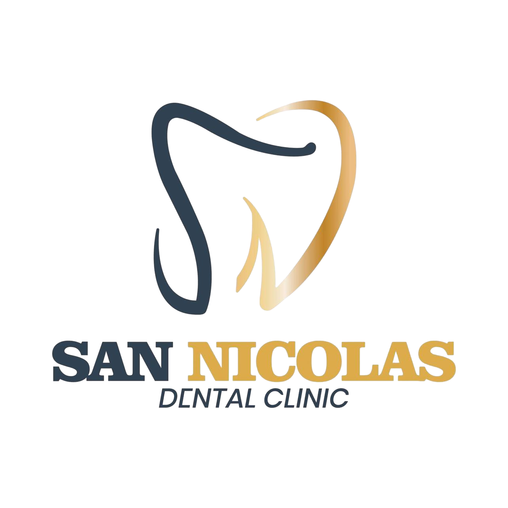

# DentDocs — San Nicolas Dental Clinic Document Management System

> **Phase 6: local semantic/hybrid search, using fictional records.**
> See [PHASE6.md](PHASE6.md) for search modes, source attribution, permissions and setup.
> See [PHASE5_HANDWRITING.md](PHASE5_HANDWRITING.md) for image-region selection,
> experimental draft suggestions and named staff review.
> See [PHASE5.md](PHASE5.md) for supported formats, staff review and processing limits.
> [PHASE4.md](PHASE4.md) records review workflows and explicit policy approval.
> See [PHASE3.md](PHASE3.md) for
> sign-in setup, permissions, verified behavior and remaining release requirements.
> [PHASE2.md](PHASE2.md) records the preceding storage and deployment phase.
> The historical prototype descriptions below are not production security claims.

<div align="center">
  
  <p><strong>Secure, Local-First Dental Record Management & Clinical Completeness System</strong></p>
  <p>Tailored for private dental practices in the Philippines, strictly compliant with Republic Act 10173 (Data Privacy Act of 2012).</p>
</div>

---

## 1. What This Project Is All About

**DentDocs** is a specialized document management and clinical completeness system designed for **San Nicolas Dental Clinic**, a community dental practice in the Philippines.

In typical dental clinics, paper records, printed X-rays, handwritten prescriptions, laboratory slips, and official receipts are easily misplaced, filed inconsistently, or stored with missing signatures and required fields. DentDocs solves this by providing a unified digital workspace that organizes, searches, and verifies the completeness of every clinical and administrative document.

### Core Principles

1. **Advisory AI ("Staff Must Verify")**  
   OCR text extraction, document classification, tooth identification, and completeness checks are strictly advisory. The system assists dental staff by highlighting missing signatures, expired clearances, and omitted PRC/PTR numbers, but licensed dental personnel retain ultimate clinical and legal responsibility.
2. **Philippine Data Privacy Act (RA 10173) Compliance**  
   Patient privacy and medical confidentiality are built into the workflow:
   - Mandatory session privacy notice and acknowledgement.
   - Strict role-based access control ensuring front desk staff cannot view clinical treatment notes or medical histories.
   - Tamper-evident, chronological audit logging for every document access, edit, and deletion.
   - Automatic 10-minute inactivity session timeout.
3. **Local-First & Offline Resilience**  
   Engineered to operate reliably across the clinic's local area network (LAN) without requiring an active internet connection, ensuring patient data remains on-premises.
4. **FDI Two-Digit Dental Charting**  
   Built-in support for the standard FDI two-digit tooth numbering system (Quadrants 1–4, Teeth 11–48) familiar to Filipino dentists.

---

## 2. Key Features & Workflows

### 📂 Clinical Document Organization
Supports 8 core document types categorized across dental procedures (Restorative, Endodontics, Oral Surgery, Orthodontics, Prosthodontics, Periodontics, Preventive, and Billing):
- **Patient Records & Charts**: Medical histories, clinical charting, allergies, and alerts.
- **Digital X-rays**: Periapical, panoramic, and bitewing radiograph records with tooth-tagging.
- **Treatment Plans**: Phased procedure roadmaps with cost estimates and consent linkage.
- **Prescriptions (Reseta)**: Rx records requiring generic names, sig/directions, dentist PRC No., and PTR No.
- **Consent Forms**: Procedure-specific consent with minor/guardian verification.
- **Laboratory Reports**: Fabrication slips for crowns, bridges, dentures, and retainers.
- **Billing / Receipts**: Official receipts, treatment payments, and balance tracking in Philippine Pesos (PHP ₱).
- **Appointment Records**: Follow-up schedules and recall logs.

### 🔍 Guided Upload & Simulated OCR Extraction
When staff drop a scanned file or photo (PDF, PNG, JPG):
1. **Scanning text**: Simulated local OCR analyzes document contents (including Taglish phrases and local date formats).
2. **Detecting type**: Auto-classifies into one of the 8 document categories with confidence scoring.
3. **Extracting clinical metadata**: Detects FDI tooth numbers, patient record IDs (`PT-2026-XXXX`), procedure types, and dates.
4. **Completeness check**: Verifies required fields against legal and practice checklists before saving.
5. **Review & verify screen**: Staff review side-by-side extracted data, edit low-confidence fields (<85%), and confirm save with audit logging.

### 🛡️ Role-Based Access Control (RBAC)
Four distinct user roles mirror the real-world staffing of the clinic:

| Role | Default User | Permissions & Scope |
| :--- | :--- | :--- |
| **Admin** | Dr. Santos | Full system administration, audit log inspection, soft-delete archiving & restoration, user management. |
| **Dentist** | Dr. Reyes | Access to all clinical records, diagnostic reviews, treatment plans, tag/tooth editing, and clinical verification. |
| **Dental Assistant** | Maria Ramos | Guided upload processing, viewing active records, tagging assistance. Cannot archive documents or edit treatment plans. |
| **Front Desk** | Joy Cruz | Billing/receipts and appointment records **ONLY**. Strict "Access Restricted" guard blocks clinical charts and medical history. |

### 📋 Completeness Engine & Clinical Alerts
- **Missing Field Validation**: Instant calculation of complete vs. missing fields (e.g. Missing Dentist Signature, Missing PTR No., Missing Guardian Consent for minors).
- **Proactive Alerts Banner**: Warns of scheduled surgeries without signed consent, expiring medical clearances, and pending approvals.
- **Action Queue**: Dedicated *Incomplete Documents* view with filterable queues and audit-logged resolutions.

### 🔒 Security, Audit & Session Controls
- **Soft-Delete with Reversibility**: Documents are archived rather than permanently purged, restorable only by Administrators.
- **Audit Trail**: Every view, download, upload, status change, and archive action generates an immutable audit record.
- **Session Privacy Modal**: Requires staff to acknowledge RA 10173 legal obligations before accessing records in a new session.
- **Inactivity Timeout**: 10-minute timer with a 60-second warning countdown toast to prevent unauthorized access at unattended terminals.

---

## 3. Technology Stack

- **Framework**: [React 19](https://react.dev/) + [TypeScript](https://www.typescriptlang.org/)
- **Bundler & Dev Server**: [Vite 8](https://vitejs.dev/)
- **Styling & Tokens**: [Tailwind CSS v4](https://tailwindcss.com/) with custom San Nicolas Clinic brand palette (Deep Navy `#0f2942`, Warm Gold `#d4a373`, Medical Teal)
- **Icons**: [Lucide React](https://lucide.dev/)
- **Animations**: [Motion](https://motion.dev/)
- **State & Data Layer**: React Context API (`ClinicContext`), simulated async API layer (`clinicApi.ts`) with realistic latency and mock data persistence.

---

## 4. Project Structure

```
DentDocs/
├── .agents/                    # Agent skills and design system guidelines
├── Assets/                     # Brand logo and visual assets
├── public/                     # Static assets (favicons, logos)
├── src/
│   ├── assets/                 # App icons and logo marks
│   ├── components/             # Reusable UI components
│   │   ├── AccessRestricted.tsx      # Guard screen for unauthorized roles
│   │   ├── ConfirmDialog.tsx         # Accessible action confirmation modal
│   │   ├── DocumentVisualPreview.tsx # Clinical document renderer & preview
│   │   ├── FdiDentalChart.tsx        # FDI 2-digit dental chart component
│   │   ├── InactivityWarningBanner.tsx# 1-minute countdown warning toast
│   │   ├── LoginModal.tsx            # Role selection & authentication modal
│   │   ├── Navbar.tsx                # Brand header, navigation, and role badge
│   │   ├── PrivacyNoticeModal.tsx    # RA 10173 session compliance modal
│   │   └── Skeletons.tsx             # Pulse loading skeleton placeholders
│   ├── context/
│   │   └── ClinicContext.tsx         # Global clinic store, actions, and audit log
│   ├── data/
│   │   ├── clinicApi.ts              # Simulated async API client
│   │   ├── clinicalAlerts.ts         # Clinical rules and alert generators
│   │   ├── completenessRequirements.ts# Required field checklists per doc type
│   │   ├── mockDocuments.ts          # Mock clinical documents (including edge cases)
│   │   ├── mockPatients.ts           # Mock patient directory
│   │   └── mockUsersAndAudit.ts      # Demo users and seed audit log
│   ├── hooks/
│   │   └── useInactivityTimer.ts     # User activity tracking & timeout hook
│   ├── types/
│   │   └── dental.ts                 # TypeScript interfaces and data models
│   ├── views/
│   │   ├── AuditLogView.tsx          # Administrator audit log inspector
│   │   ├── DashboardView.tsx         # KPI overview, alert banner, urgent queue
│   │   ├── DocumentViewerView.tsx    # Dual-pane document viewer & metadata editor
│   │   ├── IncompleteDocumentsView.tsx# Completeness action queue
│   │   ├── PatientsView.tsx          # Patient directory & profile view
│   │   ├── SearchView.tsx            # Multi-parameter search & query filter
│   │   └── UploadView.tsx            # Multi-stage guided upload & OCR review
│   ├── App.tsx                       # Main application shell & router
│   ├── index.css                     # Global styles, OKLCH colors & fonts
│   └── main.tsx                      # Application entry point
├── dentdocs_recall.md          # Architectural plan & context recall
├── dentdocs_polish_changes.md  # Detailed front-end polish changelog
├── package.json
├── tsconfig.json
└── vite.config.ts
```

---

## 5. Getting Started

### Prerequisites
- [Node.js](https://nodejs.org/) (version 18 or higher recommended)
- `npm`

### Installation & Launch

1. **Clone the repository**:
   ```bash
   git clone https://github.com/OhsirIIII/DentDocs.git
   cd DentDocs
   ```

2. **Install dependencies**:
   ```bash
   npm install
   ```

3. **Start the development server**:
   ```bash
   npm run dev
   ```
   Open [http://localhost:3000](http://localhost:3000) in your browser.

4. **Run static analysis & typecheck**:
   ```bash
   npm run lint
   ```

5. **Build for production**:
   ```bash
   npm run build
   ```

---

## 6. Target Production Architecture

The current repository provides a polished, interactive front-end prototype. The planned transition to production includes:

- **Backend**: FastAPI (Python) or Node.js with strict server-side RBAC on every endpoint.
- **Database**: PostgreSQL with `pgvector` for natural-language semantic document search.
- **Local OCR**: On-premises Tesseract or PaddleOCR containerized with Docker.
- **Storage**: Local encrypted file storage outside web roots with hash validation.
- **Deployment**: Single-command Docker Compose running entirely offline on the clinic's local server.

---

## 7. Project Documentation & Deliverables Checklist

- [ ] Project Proposal
- [ ] Software Requirements Specification (SRS)
- [ ] Use Case Diagram and User Stories
- [ ] System Architecture Diagram
- [ ] Entity Relationship Diagram (ERD)
- [ ] UI/UX Wireframes and Design Guidelines
- [ ] Software Design Document (SDD)
- [ ] API Documentation
- [x] README and Installation Guide
- [ ] Test Plan and Test Cases
- [ ] Deployment and Backup Guide
- [ ] User Manual

