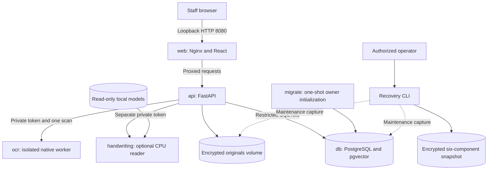
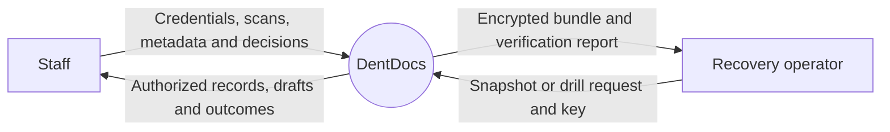
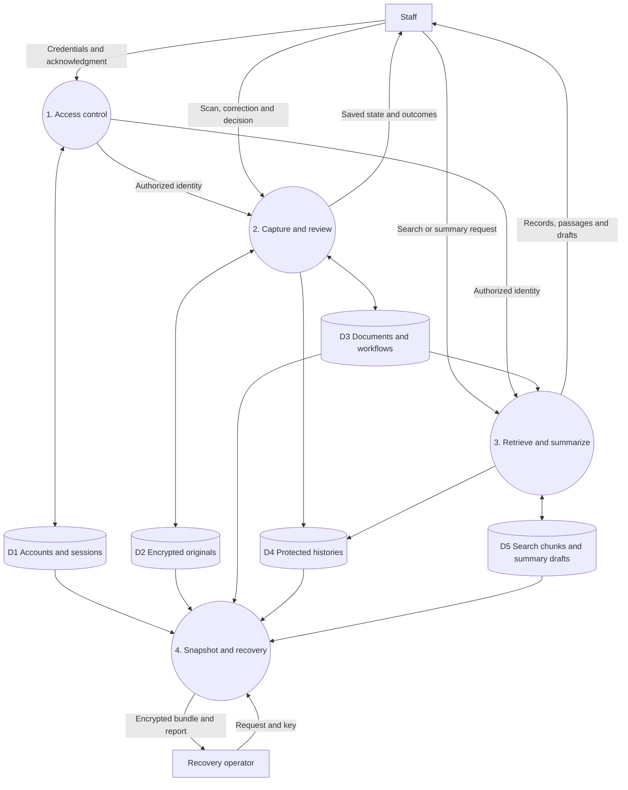
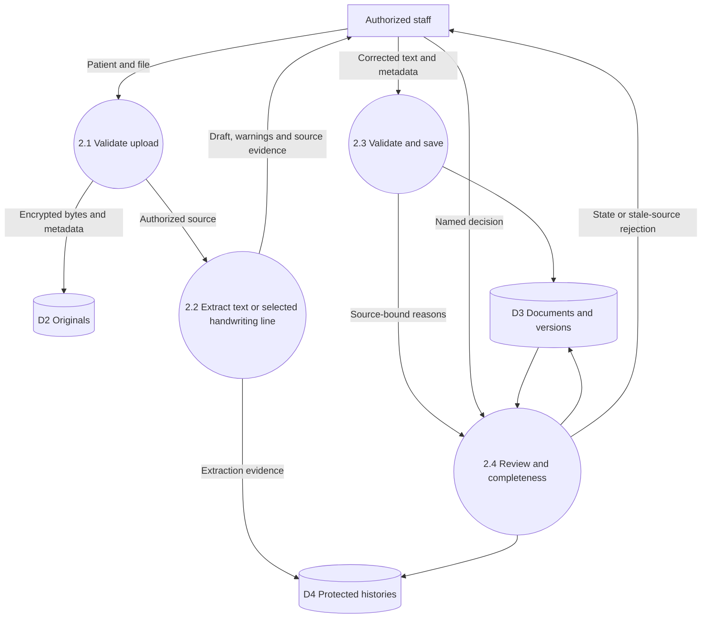
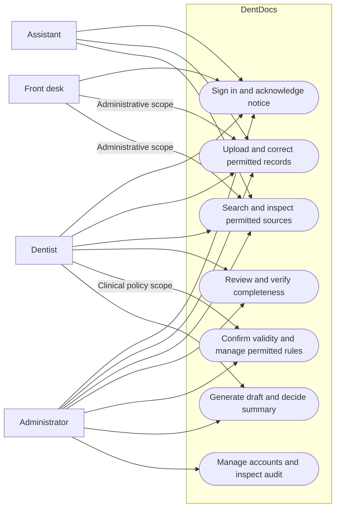
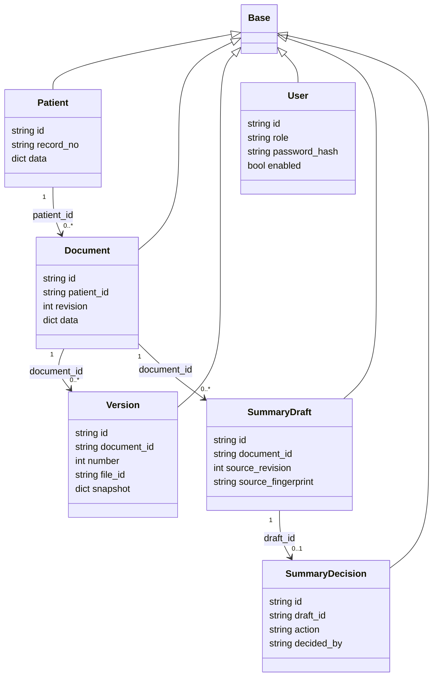
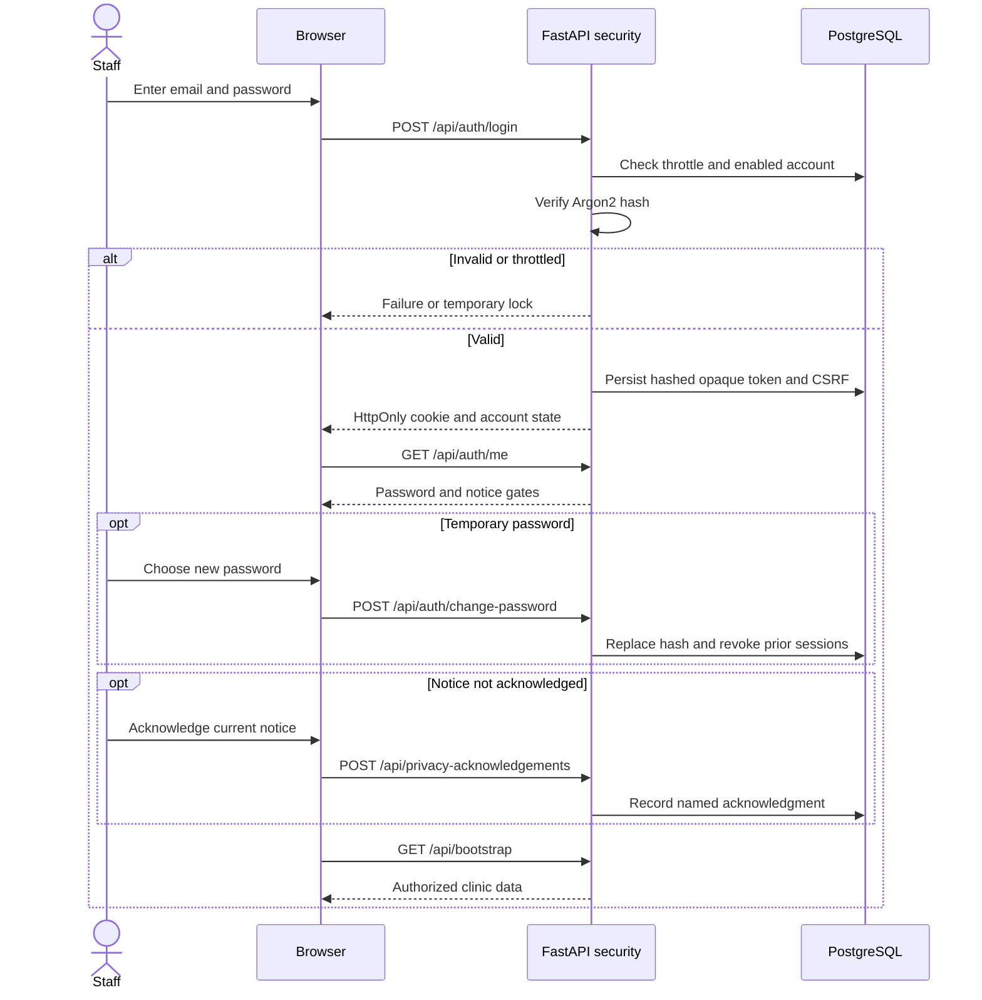
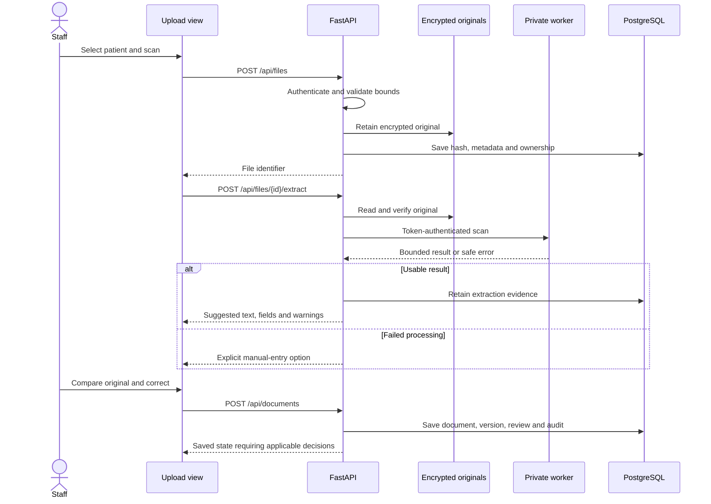
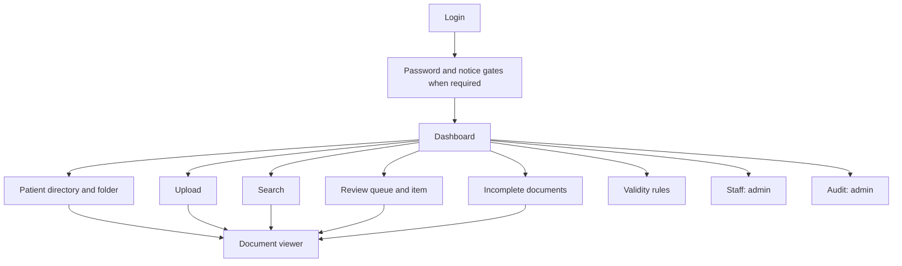

# Title Page & Preliminaries

## Title Page

**DentDocs: San Nicolas Dental Clinic Document Management System**  
System Documentation — Web Application  
Course name/code: [Software Engineering - MCS 305]  
Student names and IDs: [TO BE FILLED]  
Instructor/professor: [Mr. Jewel Jimenez]  
Submission date: [November 6, 2026]  

Implementation baseline: `c50295eb4b0394becb6f214f00de7a028f8dbb4a`, branch `codex/phase4-review-validity`. Subsequent README and recap edits remain local documentation changes. This report describes the implemented web system, not an Android application or merged production release. Android-specific template items are marked not applicable.

## Certificate / Approval Sheet

This form records academic evaluation. Its preparation does not constitute approval, clinic authorization, or security certification.

Institution/department: [TO BE FILLED]  
Project adviser: [TO BE FILLED]  
Signature: __________________________ Date: __________________

Panel member 1: [TO BE FILLED]  
Signature: __________________________ Date: __________________

Panel member 2: [TO BE FILLED]  
Signature: __________________________ Date: __________________

Department head: [TO BE FILLED]  
Signature: __________________________ Date: __________________

## Abstract / Executive Summary

DentDocs was developed to organize dental documents and support assisted transcription with explicit staff review. It retains encrypted originals, associates documents with patients, and supports metadata, versions, archiving, search, completeness and validity workflows. Printed-text extraction uses an isolated local OCR worker. An optional experimental handwriting reader produces editable suggestions for selected image lines. Administrative summaries retain source excerpts and require named approval.

The implementation uses a React and TypeScript browser interface, FastAPI, SQLAlchemy, PostgreSQL with pgvector, and Docker Compose. Native PDF processing is separated from the data-store API. Optional model inference runs locally through PyTorch and Transformers. Named accounts, server-enforced permissions, protected histories, and encrypted recovery tools were implemented.

Recorded engineering verification included 99 API tests, seven worker tests, and 25 operator/recovery tests, together with frontend checks, selected browser workflows and a fresh-volume recovery drill. These establish specific engineering behaviors rather than clinical accuracy. A small handwriting feasibility experiment reduced test character error rate from 23.5% to 18.8% on 11 research crops; exact agreement remained one line. User-supplied dental transcriptions remain unconfirmed and were not used for training. The current installation uses fictional data and loopback access. Independent security assessment, physical off-device recovery, clinic policies and release approval remain outstanding.

## Acknowledgments

The authors acknowledge the project adviser, [Mr. Jewel Jimenez], and institution, [Bulacans State University], for academic guidance. Collaborator/tester names and confirmed contributions are named to Nicolas Dental Clinic. These acknowledgments require author confirmation and do not imply that clinic staff validated transcription results. Public dataset/model contributors are credited in Appendix B.

## Table of Contents

Markdown has no fixed page layout. Each chapter, section, figure and table page number is [TO BE FILLED] after final typesetting.

- Title Page & Preliminaries: Title Page; Certificate / Approval Sheet; Abstract / Executive Summary; Acknowledgments; Table of Contents.
- Chapter 1: Introduction: Project Background; Problem Statement; Objectives; Scope and Limitations.
- Chapter 2: Literature Review / Existing Systems: Existing Systems; Comparison Matrix; Technology Background.
- Chapter 3: Requirements Analysis & Specification: Functional Requirements; Non-Functional Requirements; User Personas & User Stories; Hardware and Software Requirements.
- Chapter 4: System Design & Architecture: System Architecture; Data Flow Diagrams (DFD); ER Diagram / Database Schema; UML Diagrams; UI/UX Wireframes.
- Chapter 5: Implementation & Development: Development Environment Setup; Project Folder Structure; Core Code Implementation; Database Implementation.
- Chapter 6: Testing & Validation: Testing Strategy; Test Cases & Results; Bug Tracking & Troubleshooting.
- Chapter 7: Conclusion & Future Work: Conclusion; Future Enhancements.
- Appendices & References: Appendix A: User Manual / User Guide; Appendix B: References; Appendix C: Source Code / Repository Link.
- Final Checklist and Placeholder Register.

### List of Figures

Figure 4.1: Deployment and layered architecture.  
Figure 4.2: Context DFD.  
Figure 4.3: Level 0 DFD.  
Figure 4.4: Level 1 DFD for assisted transcription.  
Figure 4.5: Physical entity relationships.  
Figure 4.6: Use case diagram.  
Figure 4.7: Persistence class diagram.  
Figure 4.8: Login sequence.  
Figure 4.9: Upload and transcription sequence.  
Figure 4.10: Screen navigation map.  
Figure 4.11: Main-screen wireframes.  
All figure page numbers: [TO BE FILLED].

### List of Tables

Table 2.1: Existing-system comparison.  
Table 2.2: Implemented technology stack.  
Table 3.1: Functional requirements and source evidence.  
Table 3.2: Non-functional requirements and verification limits.  
Table 3.3: Role personas and user stories.  
Table 3.4: Hardware and software requirements.  
Table 4.1: Complete physical data dictionary.  
Table 4.2: Screen inventory and wireframe descriptions.  
Table 5.1: API surface by workflow.  
Table 6.1: Recorded test cases and results.  
Table 6.2: Handwriting feasibility measurements.  
Table 6.3: Bugs, causes and dispositions.  
All table page numbers: [TO BE FILLED].

# Chapter 1: Introduction

## Project Background

Dental records contain scanned forms, handwritten treatment entries, consent documents, prescriptions, receipts and appointment records. A scan preserves appearance but does not itself make the content searchable or prove transcription correctness. Supplied sample records contain cursive writing, abbreviations, overlapping strokes, table lines and mixed numeric entries. These characteristics motivated a workflow that keeps the original accessible during correction.

DentDocs began as a frontend prototype and was extended with persistent storage, authentication, OCR, source-bound review, local retrieval, administrative summaries and recovery tools. The interface identifies San Nicolas Dental Clinic; the current installation contains fictional demonstration data. Document management and assistance are implemented, while diagnosis and radiograph interpretation are outside scope.

## Problem Statement

The general problem is how to make dental documents retrievable and easier to transcribe while retaining source evidence and accountable human decisions.

1. Scans need organized patient association, original retention and recoverable change history.
2. Recognition errors must remain distinguishable from verified information.
3. Staff need separate transcription-review, completeness and validity decisions.
4. Retrieval must respect permissions and expose supporting passages.
5. Local records need controlled access, attributable actions and tested recovery.

These define the project problem; they are not findings from a quantified clinic study. Baseline retrieval times and measured clinic workload are [TO BE FILLED].

## Objectives

The general objective is to develop a dental document management system with source-preserving, staff-reviewed transcription and accountable retrieval.

The specific objectives use the documented implementation milestone of November 3, 2026 as their assessment boundary. An independently approved academic schedule is [TO BE FILLED]. They are to:

1. Implement and demonstrate patient-linked persistence, encrypted originals, versions and reversible archiving by the assessment milestone.
2. Integrate printed OCR for PDF/PNG/JPEG files of at most 20 MiB and ten PDF pages, including an explicit manual-entry path when processing fails.
3. Implement editable image-line handwriting drafts with retained source/model evidence and required human review, without assigning an unsupported accuracy target.
4. Implement four staff roles and distinct review/completeness/validity decisions, demonstrated through permission and stale-update tests.
5. Demonstrate source-linked keyword and optional semantic/hybrid retrieval and named administrative-summary decisions, including source-change invalidation.
6. Implement encrypted snapshots and demonstrate isolated restoration without replacing live data, while documenting remaining release conditions.

## Scope and Limitations

Implemented scope includes patient directories; eight document categories; permanent FDI tooth tags; uploads, preview and original downloads; editable text/metadata; versions; archive/restore; printed OCR; optional line-level handwriting; review assignment/decisions; completeness resolution; approved validity rules; keyword/semantic/hybrid search; administrative summaries; staff accounts; notice acknowledgment; audit history; and operator-run recovery.

Categories are Patient Record, X-ray, Treatment Plan, Prescription, Consent Form, Laboratory Report, Billing/Receipt and Appointment Record. These do not constitute a complete dental charting system, appointment scheduler, pharmacy system, payment ledger or diagnostic product. Patient display and association exist; separate patient-registration/editing CRUD is outside the current API.

DentDocs is a web application, not an Android APK or disconnected PWA. It requires the local server. Optional inference requires separately provisioned weights; initial package/image/model preparation requires downloads. Runtime inference is local after preparation. Handwriting assistance reads selected image lines, not guaranteed whole-page table reconstruction. Current FDI validation covers permanent teeth in quadrants 1–4, positions 1–8; pediatric and universal numbering need separate implementation.

OCR scores are heuristic, not calibrated probabilities. OCR does not authenticate signatures. Completeness is separate from validity, and unknown expiry remains unknown without a confirmed basis. Small handwriting experiments do not establish dental accuracy. No clinic-confirmed labels have been trained. No clinic usability study, broad device qualification, throughput SLA or production acceptance is claimed.

Real-patient/LAN release remains outstanding pending security assessment, physical off-device recovery, approved policies, HTTPS configuration and sign-off. Protected histories do not remove host/database-owner privileges.

# Chapter 2: Literature Review / Existing Systems

## Existing Systems

### Manual paper records and scanned folders

Paper preserves original marks; a simple scanned folder preserves a digital image. Neither necessarily provides structured metadata, accountable transcription, permission enforcement or passage-linked search. This describes the workflow represented by supplied samples, not an independently observed clinic deployment.

### Open Dental Imaging Module

Open Dental documents an Imaging Module for scanning and storing images, forms, letters and other files, including PDF import/viewing and patient-associated categories. It demonstrates established dental document organization. The cited module guide does not establish equivalent selected-line handwriting review or source-bound summary decisions (Open Dental Software, n.d.). [Official manual](https://www.opendental.com/manual/images.html).

### Dentrix Document Center

Dentrix documents a Document Center for patient letters, explanation-of-benefits documents, referral letters and scanned, captured or imported images. This supplies another established example of dental document organization. The cited window guide does not establish equivalent handwriting adaptation or source-change invalidation (Henry Schein One, n.d.). [Official help](https://hsps.pro/Dentrix/Help/mergedProjects/Document%20Center/desktop/Using_Document_Center/The_Document_Center_window.htm).

### Recognition and training data

TrOCR combines pretrained image and text Transformers and supports adaptation with paired images/transcriptions. Its research motivates transfer learning but does not prove performance on the supplied dental notes (Li et al., 2021). [Research paper](https://arxiv.org/abs/2109.10282).

African Medical Records provides paired handwritten clinical records, transcriptions and contributor metadata. Its card reports 62 paired records and 15 contributors under CC BY 4.0. Paired handwriting is relevant supervision; structured EHR tables without corresponding images are not equivalent. Nigerian clinical records nevertheless differ from the supplied Philippine dental notes and cannot substitute for dental validation (AMR Contributors, 2026). [Dataset card](https://huggingface.co/datasets/Nigeria-Health-data-OCR-pipeline/African-Medical-Records).

## Comparison Matrix

*Table 2.1: Existing-system comparison.*

| Feature | Paper / simple scanned folder | Open Dental Imaging Module | Dentrix Document Center | DentDocs |
|---|---|---|---|---|
| Retains original appearance | ✔ | ✔ | ✔ | ✔ |
| Patient-associated digital documents | ✘ | ✔ | ✔ | ✔ |
| Digital scan/import workflow | ✘ | ✔ | ✔ | ✔ |
| Selected-line experimental handwriting suggestions | ✘ | ? | ? | ✔ |
| Source-bound transcription review | ✘ | ? | ? | ✔ |
| Source-passaged semantic retrieval | ✘ | ? | ? | ✔, optional |
| Named summary approval with source invalidation | ✘ | ? | ? | ✔ |
| Established commercial dental product | ✘ | ✔ | ✔ | ✘ |

✔ indicates evidenced capability; ✘ indicates absence in the narrowly defined workflow; ? means the cited source does not establish the capability. A simple scanned folder is not a configured document-management product. Unknown competitor features are not represented as absent. The matrix does not claim replacement of competitors' wider practice-management scope. Sources were consulted November 3, 2026.

## Technology Background

*Table 2.2: Implemented technology stack.*

| Area | Actual technology | Role / repository evidence |
|---|---|---|
| Browser UI | React 19, TypeScript, React Router 7 | Typed components and navigation; `package.json`, `src/App.tsx` |
| Styling/build | Tailwind CSS 4, Vite 8, Lucide, Motion | Styling, assets, icons and transitions; package lock records exact packages |
| API | Python 3.12, FastAPI 0.162.0, Pydantic 2.14.2, Uvicorn 0.54.0 | HTTP validation and serving; `backend/requirements.lock` |
| Persistence | SQLAlchemy 2.1.6, psycopg 3.3.6, PostgreSQL 17 | Transactions and relational persistence; SQLite in isolated tests |
| Retrieval | pgvector 0.8.7, all-MiniLM-L6-v2 | 384-dimensional source-text embeddings |
| Printed OCR | Tesseract and Poppler | Printed extraction and PDF rasterization in separate worker |
| Model reader | Torch CPU 2.13.0, Transformers 5.10.0, Pillow 13.0.0 | Local TrOCR and embeddings |
| Account protection | Argon2id, opaque cookie sessions | Password hashes, hashed stored session tokens and CSRF |
| Encryption | cryptography 50.0.2 | Fernet originals and AES-256-GCM recovery components |
| Deployment | Docker Compose, Nginx | Service boundaries and loopback proxy |
| Verification | pytest, unittest, TypeScript checker, Vite build | API, worker, operator and frontend checks |

MiniLM's model card describes 384-dimensional sentence/paragraph embeddings and masked mean pooling with normalization. DentDocs loads pinned files through Transformers locally rather than a cloud embedding endpoint (Sentence Transformers, n.d.). [Model card](https://huggingface.co/sentence-transformers/all-MiniLM-L6-v2). Similarity is a retrieval signal, not clinical confidence.

# Chapter 3: Requirements Analysis & Specification

## Functional Requirements

*Table 3.1: Functional requirements and source evidence.*

| ID | Implemented acceptance behavior | Primary source |
|---|---|---|
| FR-01 | Authenticate named users; require temporary-password replacement and current notice acknowledgment | `backend/app/security.py`, `src/views/SecurityViews.tsx` |
| FR-02 | Enforce admin/dentist/assistant/front-desk permissions on server | `security.py`, `main.py` |
| FR-03 | List patients and associate documents with selected patient | `main.py`, `PatientsView.tsx` |
| FR-04 | Validate uploads, encrypt originals, retain MIME/size/hash and enforce attachment ownership | `main.py`, `database.py` |
| FR-05 | Provide bounded printed OCR with warnings and manual correction/failure path | `ocr.py`, `ocr/server.py`, `UploadView.tsx` |
| FR-06 | Provide optional image-line handwriting drafts with source/model evidence | `handwriting.py`, `UploadView.tsx` |
| FR-07 | Save typed metadata, FDI tags and corrected text with revision checks | `main.py`, `src/types/dental.ts` |
| FR-08 | Retrieve originals, retain versions and restore prior state as current state with history | `main.py`, `DocumentViewerView.tsx` |
| FR-09 | Reversibly archive records with restricted archived access | `main.py`, `security.py` |
| FR-10 | Maintain review reasons, assignment, decisions and source-change reopening | `workflows.py`, `ReviewQueueView.tsx` |
| FR-11 | Record completeness resolution separately from extraction review | `main.py`, `workflows.py` |
| FR-12 | Manage draft/approved/retired validity rules; preserve unknown default without confirmed basis | `workflows.py`, `ValidityRulesView.tsx` |
| FR-13 | Return authorized source-linked keyword/semantic/hybrid matches with explicit fallback/error | `semantic.py`, `SearchView.tsx` |
| FR-14 | Generate extractive administrative drafts; retain named decisions and invalidate stale acceptance | `summaries.py`, `DocumentViewerView.tsx` |
| FR-15 | Allow administrators to manage accounts and inspect audit | `security.py`, `AuditLogView.tsx` |
| FR-16 | Produce encrypted bundles and verify isolated fresh-volume recovery | `scripts/recovery.py`, `scripts/verify-recovery.py` |

Paths are repository-relative. Abbreviated backend filenames refer to `backend/app/`; view filenames refer to `src/views/`.

## Non-Functional Requirements

*Table 3.2: Non-functional requirements and verification limits.*

| ID | Requirement / implemented control | Evidence and limit |
|---|---|---|
| NFR-01 | Server authorization, origin/CSRF checks, Argon2id and session revocation | Security tests; no independent penetration-test certificate |
| NFR-02 | Encrypt originals and recovery; protect credentials | File/recovery tests; JSON database fields are not application-level encrypted |
| NFR-03 | Revision checks, original hashes, protected histories, source fingerprints | Stale-write/history tests; privileged owners remain trusted |
| NFR-04 | Bound upload size/pages, parser time and service resources | Worker/transport/deployment checks; no throughput SLA |
| NFR-05 | Explicit OCR failure/manual entry and search fallback | Recorded outage check; no availability percentage measured |
| NFR-06 | Authenticate full backup before use and verify restoration | Same-host 19-table/38-original comparison; physical drill pending |
| NFR-07 | Source preview, editable drafts and visible uncertainty | Selected browser checks; clinic usability study [TO BE FILLED] |
| NFR-08 | Browser client and containerized local server | Current environment; approved browser/OS matrix [TO BE FILLED] |
| NFR-09 | Modular source, locked dependencies and repeatable checks | Repository suites; no automated release pipeline claimed |
| NFR-10 | Fictional-data guard and versioned notice gate | Draft notice; approved privacy/retention policy [TO BE FILLED] |

Sessions expire after ten idle minutes or eight hours overall. Failed logins are throttled. Current loopback HTTP uses local non-secure cookies; approved HTTPS and secure-cookie configuration are required before broader deployment.

## User Personas & User Stories

*Table 3.3: Role personas and user stories.*

| Persona | Goal / pain point | User story |
|---|---|---|
| Administrator | Accountable access; shared accounts obscure responsibility | As an administrator, I want named accounts and audit records, so that access and actions are attributable. |
| Dentist | Verify source without silently trusting OCR | As a dentist, I want to compare text with the original and decide review, so that uncertainty remains explicit. |
| Assistant | Prepare records within role restrictions | As an assistant, I want editable extraction suggestions, so that I can prepare records for authorized verification. |
| Front desk | Handle administrative records within scope | As a front-desk user, I want billing/appointment documents, so that I can handle paperwork without clinical access. |
| Backup operator | Recover without damaging live data | As an authorized operator, I want encrypted snapshots and isolated drills, so that recovery can be demonstrated safely. |

Backup operator is a designated responsibility using operator tools, not a fifth application role. Personas are design descriptions, not completed interviews. Front-desk access is limited to Billing/Receipt and Appointment Record; unclassified OCR/handwriting is restricted. Assistants cannot edit treatment plans or verify completeness. Summary decisions require dentist/admin authority. Validity-rule permissions are more specific and enforced in `workflows.py`.

## Hardware and Software Requirements

*Table 3.4: Hardware and software requirements.*

| Item | Requirement / status |
|---|---|
| minSdk / targetSdk / compileSdk | Not applicable; no Android project |
| JDK / Java / Kotlin / Gradle / Android Gradle Plugin | Not applicable to the implemented stack |
| Development | Git, Python 3.12, virtual environment, Docker Desktop Linux containers and Compose |
| Host frontend checks | Node.js 22.12+ in documented 22.x line and npm; Docker supplies its own build environment |
| Database | PostgreSQL 17, pgvector 0.8.7, schema version 7 |
| IDE/version/plugins | [TO BE FILLED]; not enforced by source |
| Developer CPU/RAM/storage/OS build | [TO BE FILLED]; historical research used RTX 4050, not an end-user minimum |
| End-user browser/device | Reachable prepared server; approved browser versions [TO BE FILLED] |
| Minimum host CPU/RAM/free storage | [TO BE FILLED] after measured deployment sizing |
| Optional models | Prepared TrOCR checkpoint and pinned MiniLM artifacts, absent from Git |
| Network | Downloads for preparation; server connection for use; local inference thereafter |

API, optional reader and OCR container memory ceilings are respectively 2 GiB, 3 GiB and 1 GiB. Database/web/Docker overhead and snapshot/model storage are additional. These ceilings do not establish a tested minimum workstation specification.

# Chapter 4: System Design & Architecture

## System Architecture

DentDocs uses a layered browser-client and service architecture, not Android MVVM. React components and clinic context handle presentation/authenticated state. FastAPI modules enforce validation, permissions and workflows. SQLAlchemy persists state in PostgreSQL; encrypted originals reside in a separate volume.

*Figure 4.1: Deployment and layered architecture.*



Only web publishes a host port. OCR belongs to private `ocr_link`, shared only with API, and has no database credentials, originals/model mounts or published port. The reader uses the internal backend network and separate credential. Native modules/tools are excluded from the API image. API performs patient matching, provenance retention and persistence. Migration uses owner privileges; API uses restricted `dentdocs_app`. API/reader/OCR run nonroot with read-only roots, dropped capabilities and bounded resources. Isolation reduces exposure; it does not eliminate upstream library vulnerabilities.

## Data Flow Diagrams (DFD)

DFDs describe logical data movement. Staff and the recovery operator are external entities; native/model services are internal processors. Stores include relational state, encrypted originals and protected snapshots.

*Figure 4.2: Context DFD.*



*Figure 4.3: Level 0 DFD.*



Recovery also captures configuration, tracked/staged source, models and runtime images. It is an operator-triggered maintenance process, not a scheduled browser feature.

*Figure 4.4: Level 1 DFD for assisted transcription.*



OCR outage returns an explicit error. Staff can manually enter text against the retained original; failed processing is not recorded as successful OCR. Review acceptance does not automatically resolve completeness or validity.

## ER Diagram / Database Schema

`backend/app/database.py` declares 21 physical tables. PostgreSQL is deployed; SQLite supports tests. `String` has no fixed declared length. String timestamps are not SQL timestamp columns. JSON holds structured application payloads. Encrypted original bytes are outside the database.

*Figure 4.5: Physical entity relationships.*

```mermaid
erDiagram
  patients ||--o{ documents : patient_id
  documents ||--o{ document_versions : document_id
  document_files o|--o{ document_versions : file_id
  users ||--o{ sessions : user_id
  users ||--o{ privacy_acknowledgements : user_id
  document_files ||--o| file_uploads : file_id
  users ||--o{ file_uploads : user_id
  document_files ||--o| file_extractions : file_id
  patients ||--o{ file_extractions : patient_id
  document_files ||--o{ handwriting_drafts : file_id
  patients ||--o{ handwriting_drafts : patient_id
  users ||--o{ handwriting_drafts : user_id
  documents ||--o{ search_chunks : document_id
  documents ||--o{ summary_drafts : document_id
  document_files o|--o{ summary_drafts : file_id
  users ||--o{ summary_drafts : created_by
  summary_drafts ||--o| summary_decisions : draft_id
  users ||--o{ summary_decisions : decided_by
  documents ||--o{ review_queue : document_id
  users o|--o{ review_queue : assignee_id
  users o|--o{ review_queue : decided_by
  review_queue ||--o{ review_events : review_id
  users ||--o{ validity_rules : created_by
  users o|--o{ validity_rules : approved_by
  documents ||--o{ document_validity : document_id
  documents o|--o{ document_validity : appointment_id
  validity_rules o|--o{ document_validity : rule_id
  users ||--o{ document_validity : confirmed_by
  documents ||--o{ validity_events : document_id
  audit_logs {
    string id PK
  }
  schema_versions {
    int version PK
  }
  login_throttles {
    string key PK
  }
```



Optional parent ends represent nullable foreign keys. JSON references are not physical foreign keys. Audit, schema version and throttle tables have no physical relationships. The dictionary supplies every mapped column, including fields omitted from the compact diagram.

*Table 4.1: Complete physical data dictionary.*

| Table | Column | Type | Constraints / reference |
|---|---|---|---|
| `patients` | `id` | String | PK; not null |
| `patients` | `record_no` | String | not null; unique |
| `patients` | `data` | JSON | not null |
| `documents` | `id` | String | PK; not null |
| `documents` | `patient_id` | String (inferred) | not null; FK patients.id |
| `documents` | `revision` | Integer | not null; default 1 |
| `documents` | `data` | JSON | not null |
| `document_files` | `id` | String | PK; not null |
| `document_files` | `mime` | String | not null |
| `document_files` | `size` | Integer | not null |
| `document_files` | `sha256` | String | not null |
| `document_files` | `created_at` | String | not null |
| `document_versions` | `id` | String | PK; not null |
| `document_versions` | `document_id` | String (inferred) | not null; FK documents.id |
| `document_versions` | `number` | Integer | not null |
| `document_versions` | `file_id` | String (inferred) | nullable; FK document_files.id |
| `document_versions` | `snapshot` | JSON | not null |
| `audit_logs` | `id` | String | PK; not null |
| `audit_logs` | `data` | JSON | not null |
| `schema_versions` | `version` | Integer | PK; not null |
| `users` | `id` | String | PK; not null |
| `users` | `email` | String | not null; unique |
| `users` | `name` | String | not null |
| `users` | `role` | String | not null |
| `users` | `title` | String | not null |
| `users` | `password_hash` | String | not null |
| `users` | `enabled` | Boolean | not null; default True |
| `users` | `must_change` | Boolean | not null; default True |
| `users` | `revision` | Integer | not null; default 1 |
| `sessions` | `token_hash` | String | PK; not null |
| `sessions` | `user_id` | String (inferred) | not null; FK users.id |
| `sessions` | `csrf` | String | not null |
| `sessions` | `last_seen` | Float | not null |
| `sessions` | `created_at` | Float | not null |
| `sessions` | `revoked` | Boolean | not null; default False |
| `privacy_acknowledgements` | `id` | String | PK; not null |
| `privacy_acknowledgements` | `user_id` | String (inferred) | not null; FK users.id |
| `privacy_acknowledgements` | `notice_version` | String | not null |
| `privacy_acknowledgements` | `timestamp` | String | not null |
| `login_throttles` | `key` | String | PK; not null |
| `login_throttles` | `failures` | Integer | not null; default 0 |
| `login_throttles` | `locked_until` | Float | not null; default 0 |
| `file_uploads` | `file_id` | String (inferred) | PK; not null; FK document_files.id |
| `file_uploads` | `user_id` | String (inferred) | not null; FK users.id |
| `file_uploads` | `consumed` | Boolean | not null; default False |
| `file_extractions` | `file_id` | String (inferred) | PK; not null; FK document_files.id |
| `file_extractions` | `patient_id` | String (inferred) | not null; FK patients.id |
| `file_extractions` | `result` | JSON | not null |
| `handwriting_drafts` | `id` | String | PK; not null |
| `handwriting_drafts` | `file_id` | String (inferred) | not null; FK document_files.id |
| `handwriting_drafts` | `patient_id` | String (inferred) | not null; FK patients.id |
| `handwriting_drafts` | `user_id` | String (inferred) | not null; FK users.id |
| `handwriting_drafts` | `data` | JSON | not null |
| `search_chunks` | `id` | String | PK; not null |
| `search_chunks` | `document_id` | String (inferred) | not null; FK documents.id |
| `search_chunks` | `revision` | Integer | not null |
| `search_chunks` | `number` | Integer | not null |
| `search_chunks` | `field` | String | not null |
| `search_chunks` | `start` | Integer | not null |
| `search_chunks` | `end` | Integer | not null |
| `search_chunks` | `snippet` | String | not null |
| `search_chunks` | `fingerprint` | String | not null |
| `search_chunks` | `model_id` | String | not null |
| `search_chunks` | `embedding` | JSON in SQLite / vector(384) in PostgreSQL | not null |
| `summary_drafts` | `id` | String | PK; not null |
| `summary_drafts` | `document_id` | String (inferred) | not null; FK documents.id |
| `summary_drafts` | `source_revision` | Integer | not null |
| `summary_drafts` | `source_version` | Integer | not null |
| `summary_drafts` | `source_fingerprint` | String | not null |
| `summary_drafts` | `source_type` | String | not null |
| `summary_drafts` | `file_id` | String (inferred) | nullable; FK document_files.id |
| `summary_drafts` | `created_by` | String (inferred) | not null; FK users.id |
| `summary_drafts` | `data` | JSON | not null |
| `summary_decisions` | `id` | String | PK; not null |
| `summary_decisions` | `draft_id` | String (inferred) | not null; FK summary_drafts.id |
| `summary_decisions` | `action` | String | not null |
| `summary_decisions` | `decided_by` | String (inferred) | not null; FK users.id |
| `summary_decisions` | `data` | JSON | not null |
| `review_queue` | `id` | String | PK; not null |
| `review_queue` | `document_id` | String (inferred) | not null; FK documents.id |
| `review_queue` | `version` | Integer | not null |
| `review_queue` | `source_fingerprint` | String | not null |
| `review_queue` | `status` | String | not null; default 'pending' |
| `review_queue` | `reasons` | JSON | not null |
| `review_queue` | `assignee_id` | String (inferred) | nullable; FK users.id |
| `review_queue` | `decided_by` | String (inferred) | nullable; FK users.id |
| `review_queue` | `decided_at` | String | nullable |
| `review_queue` | `decision_note` | String | nullable |
| `review_queue` | `updated_at` | String | not null |
| `review_queue` | `revision` | Integer | not null; default 1 |
| `review_events` | `id` | String | PK; not null |
| `review_events` | `review_id` | String (inferred) | not null; FK review_queue.id |
| `review_events` | `data` | JSON | not null |
| `validity_rules` | `id` | String | PK; not null |
| `validity_rules` | `document_type` | String | not null |
| `validity_rules` | `category` | String | not null |
| `validity_rules` | `version` | Integer | not null |
| `validity_rules` | `valid_for_days` | Integer | not null |
| `validity_rules` | `warning_days` | Integer | not null |
| `validity_rules` | `reference` | String | not null |
| `validity_rules` | `status` | String | not null; default 'draft' |
| `validity_rules` | `created_by` | String (inferred) | not null; FK users.id |
| `validity_rules` | `approved_by` | String (inferred) | nullable; FK users.id |
| `validity_rules` | `approved_at` | String | nullable |
| `validity_rules` | `approval_note` | String | nullable |
| `validity_rules` | `revision` | Integer | not null; default 1 |
| `document_validity` | `id` | String | PK; not null |
| `document_validity` | `document_id` | String (inferred) | not null; FK documents.id |
| `document_validity` | `version` | Integer | not null |
| `document_validity` | `source_fingerprint` | String | not null |
| `document_validity` | `basis` | String | not null |
| `document_validity` | `category` | String | not null |
| `document_validity` | `issued_on` | Date | nullable |
| `document_validity` | `expires_on` | Date | nullable |
| `document_validity` | `warning_days` | Integer | not null; default 0 |
| `document_validity` | `rule_id` | String (inferred) | nullable; FK validity_rules.id |
| `document_validity` | `appointment_id` | String (inferred) | nullable; FK documents.id |
| `document_validity` | `appointment_revision` | Integer | nullable |
| `document_validity` | `confirmed_by` | String (inferred) | not null; FK users.id |
| `document_validity` | `confirmed_at` | String | not null |
| `document_validity` | `note` | String | not null |
| `document_validity` | `revision` | Integer | not null; default 1 |
| `validity_events` | `id` | String | PK; not null |
| `validity_events` | `document_id` | String (inferred) | not null; FK documents.id |
| `validity_events` | `data` | JSON | not null |

Additional constraints: versions are unique on `(document_id, number)` with `number > 0`; acknowledgments on `(user_id, notice_version)`; chunks on `(document_id, number)`; summary decisions on `draft_id`, restricted to approve/reject; review/validity on `(document_id, version)`; rules on `(document_type, category, version)`.

Logical JSON types are in `src/types/dental.ts` and `src/types/workflows.ts`. Patient payloads contain identity/contact information, birth date, alerts, guardian details, visit dates and tooth arrays. Document payloads contain classification/date, patient display references, teeth/category/tags, confidence, completeness/missing fields, text, file linkage, upload/review metadata, versions, optional prescription/radiograph fields and archive state. These are not separate normalized treatment, prescription, payment or appointment tables.

## UML Diagrams

### Use Case Diagram

Mermaid flowchart notation represents actors and use cases within the system boundary.

*Figure 4.6: Use case diagram.*



Use-case access is subject to finer action checks. Upload access does not imply treatment-plan edit or verification authority. Other authorized users may generate drafts; summary decisions remain dentist/admin actions.

### Class Diagram

Persistent classes inherit SQLAlchemy's declarative base. Workflow logic primarily consists of functions installed on FastAPI, not invented controller/ViewModel classes.

*Figure 4.7: Persistence class diagram.*



### Sequence Diagrams

*Figure 4.8: Login sequence.*



*Figure 4.9: Upload and transcription sequence.*



Handwriting uses `/api/files/{id}/handwriting` with an image box/rotation and a separate retained draft source. It does not silently replace printed extraction provenance.

## UI/UX Wireframes

*Figure 4.10: Screen navigation map.*



Eligible users pass gates without repeated acknowledgment. All record actions remain subject to server authorization.

*Figure 4.11: Main-screen wireframes.*

```text
LOGIN / PASSWORD / NOTICE
+----------------------------------------------------------+
| DentDocs                                                 |
| Email [____________] Password [____________] [Sign in]     |
| Conditional password replacement / notice acknowledgment |
+----------------------------------------------------------+

AUTHENTICATED SHELL
+----------------------------------------------------------+
| DentDocs | Navigation | Named staff / role | Sign out     |
| Page title and status / errors                           |
| Page-specific panels described in Table 4.2              |
| Fictional prototype data / clinic footer                 |
+----------------------------------------------------------+

UPLOAD
+----------------------------+-----------------------------+
| Patient / file selection   | Original preview            |
| Extraction status          | Image crop / rotation       |
| Editable text and metadata | Handwriting draft evidence  |
| Warnings / save            | Request suggestion          |
+----------------------------+-----------------------------+

DOCUMENT VIEWER
+----------------------------+-----------------------------+
| Title / patient / version  | Original preview            |
| Text / tags / metadata     | Version/source selection    |
| Review / completeness     | Download / print request    |
| Validity / summary history |                             |
+----------------------------+-----------------------------+
```

*Table 4.2: Screen inventory and wireframe descriptions.*

| Main screen / route | Existing component and layout |
|---|---|
| Login/password | `SecurityViews.tsx`: credentials/error state and forced replacement form |
| Notice gate | `PrivacyNoticeModal.tsx`: versioned notice and acknowledgment |
| `/dashboard` | `DashboardView.tsx`: overview/status cards and workflow navigation |
| `/patients`, `/patients/:patientId` | `PatientsView.tsx`: directory/search, patient details, tooth context and document list |
| `/upload` | `UploadView.tsx`: selection, preview, extraction/crop, editable fields/text, warnings/save |
| `/documents/:documentId` | `DocumentViewerView.tsx`: original/text, metadata, versions, review/completeness/validity and summaries |
| `/search` | `SearchView.tsx`: query/filter/mode controls, source-linked results and fallback/errors |
| `/review`, `/review/:reviewId` | `ReviewQueueView.tsx`: queue, reasons, assignment, source-linked item and decision form |
| `/validity-rules` | `ValidityRulesView.tsx`: rules, type/category, reference, draft/approve/retire controls |
| `/incomplete` | `IncompleteDocumentsView.tsx`: incomplete records and corrective links |
| `/admin/audit` | `AuditLogView.tsx`: administrator event list and filtering |
| `/admin/users` | `UsersView` in `SecurityViews.tsx`: list/create/edit/reset/disable named accounts |

These are low-fidelity descriptions of implemented screens. Appendix A registers the screenshots needed for an illustrated submission.

# Chapter 5: Implementation & Development

## Development Environment Setup

The documented environment uses Windows PowerShell, Python 3.12, Git and Docker Desktop Linux containers. Node.js 22.12+ in the documented 22.x line supports host frontend checks; Docker supplies its own build environment. IDE/version/plugins and exact OS build are [TO BE FILLED]. Android Studio, Gradle, emulators and Android devices are not implementation requirements.

For a **new fictional-data installation only**, with no existing `.env`:

```powershell
git clone --branch codex/phase4-review-validity https://github.com/OhsirIIII/DentDocs.git
cd DentDocs
python -m venv .venv
.venv/Scripts/python.exe -m pip install -r backend/requirements.lock
.venv/Scripts/python.exe scripts/create-env.py
.venv/Scripts/python.exe scripts/bootstrap-admin.py
docker compose up --build -d
```

Open `http://127.0.0.1:8080`. The generated administrator uses `admin@dentdocs.local`; read its temporary password privately from ignored `work/initial-admin.txt`, replace it, and acknowledge the notice. Never publish passwords or configuration. Preserve existing encryption keys and volumes; regenerating keys does not recover old originals.

For an **existing prepared installation**:

```powershell
docker compose --profile semantic up --build -d
docker compose --profile semantic ps
```

Optional inference requires `work/handwriting/amr-base-run-001/trained/`. After provisioning those weights, use `scripts/configure-semantic.py` and `scripts/configure-handwriting.py`. Source-only clones lack weights. Semantic/handwriting profiles enable the same reader. Without it, printed OCR/manual entry work; hybrid reports keyword fallback and semantic-only requests report unavailability.

The frontend-only server uses port 3000 and expects a separate API on port 8000. Compose does not publish API port 8000. Thus `npm run dev` alone is not the documented full-stack startup.

## Project Folder Structure

Relevant actual paths are shown below; generated/private directories are omitted.

```text
DentDocs/
  src/
    App.tsx
    components/
    context/ClinicContext.tsx
    types/dental.ts
    types/workflows.ts
    views/                 # Screens listed in Table 4.2
  backend/
    app/
      main.py
      asgi.py
      database.py
      initialize.py
      security.py
      workflows.py
      summaries.py
      semantic.py
      handwriting.py
      ocr.py
      ocr_protocol.py
      ocr_native.py
      ocr_worker.py
    tests/
    requirements.lock
    Dockerfile
  ocr/
    server.py
    test_server.py
    test_native.py
    Dockerfile
  handwriting/
  deployment/database/
  scripts/
    create-env.py
    bootstrap-admin.py
    configure-ocr.py
    configure-semantic.py
    configure-handwriting.py
    recovery.py
    verify-deployment.py
    verify-security.py
    verify-recovery.py
    tests/
  training/
    prepare_amr.py
    prepare_amr_lines.py
    train_names.py
    transcribe_line.py
    import_dental_review.py
    README.md
  compose.yaml
  Dockerfile
  README.md
  SESSION_RECAP.md
```

Clinic context coordinates authenticated API state; views implement screens; types describe payloads. Backend modules separate persistence/security/workflows/retrieval. Native modules remain in source for the separate worker build but are removed from the API image. Scripts are operator tools; training contains research workflows. Ignored `work/` is private local material, not distributable source.

## Core Code Implementation

### Server-side authorization

Source: `backend/app/security.py`.

```python
def can_read(user, doc):
    return (user['role'] == 'admin' or not doc.get('archived')) and (user['role'] != 'front_desk' or doc['type'] in ADMINISTRATIVE)


def authorize(user, doc, write=False, verify=False):
    if not can_read(user, doc):
        raise HTTPException(403, 'Your account cannot access this document')
    if write and user['role'] == 'assistant' and doc['type'] == 'Treatment Plan':
        raise HTTPException(403, 'Treatment plans can be changed only by a dentist or administrator')
    if verify and user['role'] not in {'admin', 'dentist'}:
        raise HTTPException(403, 'A dentist or administrator must verify completeness')
```

The server restricts archived and front-desk clinical access, assistant treatment-plan edits and completeness verification. Hidden UI controls do not replace these checks.

### Bounded isolated OCR transport

Source: `backend/app/ocr.py` (initial validation/concurrency gate).

```python
def run_local(payload, mime):
    url,token=os.getenv('OCR_URL',''),os.getenv('OCR_TOKEN','')
    if not url or len(token)<32:
        raise OcrError('Local OCR service is unavailable. Retry or enter text manually.')
    if mime not in {'application/pdf','image/png','image/jpeg'} or not 0<len(payload)<=MAX_FILE:
        raise OcrError('Use a PDF, PNG or JPEG of at most 20 MB.')
    if not SLOTS.acquire(blocking=False):raise OcrError('Local OCR is busy. Please retry shortly.')
```

The API requires a configured private credential, validates MIME/size and limits transport concurrency. The remaining function disables redirects/environment proxies, bounds response reads, validates output and handles timeouts safely. It never falls back to native parsing inside API. The worker processes one bounded native job at a time and cleans temporary files.

### Source-bound administrative summaries

Source: `backend/app/summaries.py`.

```python
def fingerprint(row):
    return hashlib.sha256(json.dumps({'revision': row.revision, 'source': row.data}, sort_keys=True).encode()).hexdigest()
```

The fingerprint includes revision and full source JSON. Generation selects up to three short administrative-cue lines with exact quotes/offsets; it is not a generative clinical narrative. A dentist/admin provides a named decision, note and explicit confirmation. Current revision/review checks prevent stale acceptance.

### Retrieval and model integration

`backend/app/semantic.py` binds text chunks to document revision/fingerprint, field and offsets. The local reader uses pinned MiniLM weights. Filters/permissions and freshness checks govern matches. Similarity is heuristic; accepted summaries are not separately indexed as source evidence.

`backend/app/handwriting.py` validates image boxes/rotation and retains draft source/model hashes and staff identity. Handwriting confidence is null and verification remains required. `training/import_dental_review.py` admits only explicitly verified accepted crops with corrected text, reviewer/writer information and matching hashes; it does not automatically train or split candidates.

### Recovery implementation

`scripts/recovery.py` encrypts six components: database, originals, private configuration, source, models and runtime images. AES-256-GCM uses fresh nonces and authenticated component identity; an encrypted manifest records sizes/hashes. A separate recovery key protects the bundle; original-file keys are retained inside encrypted configuration.

The tool stops web/API writers briefly during capture and restarts them in a `finally` block. This is maintenance, not an unrestricted multi-writer backup guarantee. Source capture selects tracked/staged files. All components authenticate before extraction/execution; archives reject traversal/links. Drills restore exact images into new isolated projects/volumes and revoke restored sessions. No recurring backup scheduler is installed.

*Table 5.1: API surface by workflow.*

| Workflow | Routes relative to `/api` | Contract |
|---|---|---|
| Health/bootstrap | `GET /health`, `GET /bootstrap` | Health public; clinic data authorized/scoped |
| Authentication | `POST /auth/login`, `GET /auth/me`, `POST /auth/logout`, `/auth/activity`, `/auth/change-password` | Cookie sessions, gates, CSRF/origin and revocation |
| Notice | `POST /privacy-acknowledgements` | User/current notice version |
| Staff | `GET/POST /admin/users`, `PATCH /admin/users/{id}`, `POST /admin/users/{id}/reset-password` | Admin-only, revision and account safeguards |
| Files | `POST /files`, `/files/{id}/extract`, `/files/{id}/handwriting` | Ownership, bounds and restricted processing |
| Documents | `GET /documents/{id}`, `POST /documents`, `PATCH /documents/{id}` | Permission and expected-revision checks |
| Original/version | `GET /documents/{id}/file`, `POST /documents/{id}/versions`, `/documents/{id}/versions/{number}/restore` | Authorized retrieval and retained snapshots |
| Document actions | `POST /documents/{id}/archive`, `/restore-archive`, `/completeness-resolution`, `/print` | Action-specific authority; print logs a request, not printer completion |
| Search | `POST /documents/search`, `POST /search` | Legacy keyword and mode-aware retrieval |
| Review | `GET /reviews`, `GET /reviews/{id}`, `POST /reviews/referrals`, `PATCH /reviews/{id}`, `POST /reviews/{id}/decision` | Source-bound assignment/decisions |
| Validity | `GET/POST /validity-rules`, `POST /validity-rules/{id}/approve`, `/retire`, `GET/PUT /documents/{id}/validity` | Versioned approved rules or explicit confirmed basis |
| Summaries | `GET/POST /documents/{id}/summaries`, `POST /documents/{id}/summaries/{draft}/decision` | Draft history, named decision and invalidation |

Abbreviated action suffixes retain their preceding resource path and method. Pydantic schemas in the source are authoritative for fields. Failures distinguish validation, missing authentication, forbidden action, stale state and service unavailability. Worker routes are not public staff APIs.

## Database Implementation

Source: `backend/app/database.py`.

```python
class Version(Base):
    __tablename__ = 'document_versions'
    __table_args__ = (UniqueConstraint('document_id', 'number'), CheckConstraint('number > 0'))
    id: Mapped[str] = mapped_column(String, primary_key=True)
    document_id: Mapped[str] = mapped_column(ForeignKey('documents.id'))
    number: Mapped[int] = mapped_column(Integer)
    file_id: Mapped[str | None] = mapped_column(ForeignKey('document_files.id'), nullable=True)
    snapshot: Mapped[dict] = mapped_column(JSON)
```

Versions require a positive per-document unique number and retain structured snapshots and optional original linkage. SQLite explicitly enables foreign keys; PostgreSQL is the deployed database.

Custom migration creates the vector extension before tables and records schema versions 1–7. Additive `create_all` does not migrate arbitrary column changes; future changes require numbered migrations. No Alembic history is claimed.

Triggers protect `audit_logs`, `review_events`, `validity_events`, `file_extractions`, `handwriting_drafts`, `summary_drafts` and `summary_decisions`: update/delete are rejected on SQLite and update/delete/truncate on PostgreSQL. `initialize.py` separately restricts runtime grants and schema-version mutation. Protected histories remain subject to privileged-owner trust. Revision checks and transactions guard document/workflow changes; derived search evidence must match current sources.

# Chapter 6: Testing & Validation

## Testing Strategy

Verification used pytest API/integration tests, Python unittest for workers, operator/recovery tests, TypeScript checking, production builds and selected real browser workflows. JUnit, Espresso and `androidTest` are not applicable. Application suites were not rerun solely for this report; the following are recorded implementation results, not new clinic acceptance.

The latest evidence recorded 99 backend tests, seven worker/native tests and 25 operator/recovery tests: 131 total. Suites include `backend/tests/test_api.py`, `test_security.py`, `test_additional_security.py`, `test_ocr.py`, `test_ocr_transport.py`, `test_handwriting.py`, `test_semantic.py`, `test_workflows.py`, `test_summaries.py`, `ocr/test_server.py`, `ocr/test_native.py` and `scripts/tests/`.

Browser checks covered upload, printed OCR, PDF preview, summary acceptance/history/reload/source invalidation and actual worker outage with manual save. Deployment checks inspected networks, effective restrictions, absent native tools in API and denied worker-to-database connection. Recovery compared restored content before user interactions.

Evidence summaries: [PARSER_ISOLATION.md](PARSER_ISOLATION.md), [PHASE8.md](PHASE8.md), [SECURITY_FOLLOWUP.md](SECURITY_FOLLOWUP.md), [SESSION_RECAP.md](SESSION_RECAP.md). Detailed ignored `work/parser-isolation/` artifacts are private operational material. Clinic UAT participants, protocol and signed results are [TO BE FILLED].

## Test Cases & Results

*Table 6.1: Recorded test cases and results.*

| Test Case ID | Description | Test Steps | Expected Output | Actual Output | Status (Pass/Fail) |
|---|---|---|---|---|---|
| TC-01 | Authentication/gates | Sign in; exercise temporary-password/notice state | Access blocked until required gates pass | Recorded security suite passed | Pass |
| TC-02 | Role restrictions | Request clinical/archived records and restricted actions under each role | Unauthorized access rejected | Permission tests passed | Pass |
| TC-03 | Patient-linked persistence | Create/retrieve document for patient | Correct saved association | API tests passed | Pass |
| TC-04 | Original/version integrity | Upload/download, add version, restore | Original hash/history preserved | API and recovery checks passed | Pass |
| TC-05 | Printed OCR | Extract readable PDF/image and inspect | Real text, warnings and provenance | Browser OCR/PDF and suites passed | Pass |
| TC-06 | Parser boundary | Invalid inputs/responses and unauthorized worker request | Bounded rejection, no false extraction | Transport/worker tests passed | Pass |
| TC-07 | OCR outage | Stop worker, manually enter/save | Retained original; zero confidence; pending review; no false OCR source | Actual browser check matched | Pass |
| TC-08 | Handwriting | Select crop/rotation; request and retain draft | Editable draft with source/model evidence and no calibrated confidence | Integration tests/inference smoke check passed | Pass |
| TC-09 | Stale revision | Submit outdated change/decision | Conflict rejected | API/workflow tests passed | Pass |
| TC-10 | Archive/restore | Archive, test visibility, restore | Reversible authorized state | API/security tests passed | Pass |
| TC-11 | Review freshness | Assign/decide; edit source; retry stale decision | Required checks and reopening | Workflow tests passed | Pass |
| TC-12 | Separate completeness | Refer/review and inspect completeness | No silent completeness promotion | Workflow tests passed | Pass |
| TC-13 | Validity policy | Query no basis; attempt draft rule; approve/apply/retire | Unknown default and approved-rule constraints | Validity boundary tests passed | Pass |
| TC-14 | Retrieval | Query roles/filters; edit source; simulate reader failure | Authorized fresh matches and explicit fallback/error | Semantic tests passed | Pass |
| TC-15 | Summaries | Generate/approve/reload; edit source | Immutable decision and stale acceptance invalidation | Suite and browser check passed | Pass |
| TC-16 | Staff/audit | Create/reset/disable account; test forbidden access | Admin controls and attributable actions | Security/API suites passed | Pass |
| TC-17 | Protected history | Attempt prohibited history mutations | Mutation rejected | Database/security checks passed | Pass |
| TC-18 | Worker isolation | Inspect runtime; try database TCP from worker | No DB access/credentials/mounts | Live/recovered checks passed | Pass |
| TC-19 | Full recovery | Backup, fresh-volume drill, compare before interaction | Authenticated exact content recovery | 19 table hashes and 38 decrypt/SHA checks matched; sessions revoked | Pass |
| TC-20 | Unsafe recovery inputs | Alter components; test traversal/unsafe targets | Refusal before unsafe execution | Operator/recovery suite passed | Pass |
| TC-21 | Frontend | Type-check and production build | Successful checks | Passed with known advisories | Pass |
| TC-22 | Clinic/device acceptance | Run approved staff/device protocol | Signed acceptance and usability results | [TO BE FILLED] | [TO BE FILLED] |
| TC-23 | Physical off-device recovery | Second machine/operator/key custody | Independently demonstrated recovery | [TO BE FILLED] | [TO BE FILLED] |

TC-08 validates software behavior, not correctness of every dental word. TC-19 excludes operational `sessions` and `login_throttles` from content equivalence; 21 physical tables exist and restored sessions are intentionally revoked.

### Handwriting feasibility

The pipeline prepared 47 clinical-line crops from three writers: 21 train, 15 validation and 11 test, separated by writer. Labels were assistant-checked and not independently clinician-confirmed. Base TrOCR adaptation used 64 optimizer steps with a frozen image encoder. The test split was examined during feasibility work; it is not an untouched release benchmark.

*Table 6.2: Handwriting feasibility measurements.*

| Measure | Pretrained base | Adapted base | Scope |
|---|---|---|---|
| Validation CER | 28.0% | 24.1% | 15 crops |
| Test CER | 23.5% | 18.8% | 11 crops |
| Validation exact lines | 1/15 | 2/15 | Limited exact agreement |
| Test exact lines | 1/11 | 1/11 | No exact-line improvement |

CER is character edit distance divided by reference length after uppercase/whitespace normalization, retaining punctuation. It can exceed 100%; it is not confidence or clinical field accuracy. Historical training used Torch 2.7.1+cu128 and Transformers 4.57.1. Current CPU upgrades smoke-tested inference but did not rerun CER. Details: [training/README.md](training/README.md).

The private dental packet contains 24 procedure-line crops from five unique photos. Supplied transcriptions were explicitly identified as draft/unconfirmed. Zero verified candidates passed the initial import gate; photos/labels were not trained or imported into the app. Meaningful dental evaluation requires confirmed labels, multiple writers, a fresh held-out split and field-error analysis. Synthea EHR CSVs alone do not supply handwriting supervision.

## Bug Tracking & Troubleshooting

*Table 6.3: Bugs, causes and dispositions.*

| Bug ID | Description | Cause / evidence | Resolution | Status |
|---|---|---|---|---|
| BUG-01 | Cold restore readiness race | Temporary database startup satisfied weaker readiness; drill record | Wait for final TCP listener; transactional import | Fixed; final drill passed at `c50295e` |
| BUG-02 | Native parser shared datastore runtime | Earlier parser placement; `PARSER_ISOLATION.md` | Separate bounded worker/network/token; remove native tools from API | Isolation verified in `c50295e`; upstream findings remain |
| BUG-03 | Invalid earlier handwriting evaluation | Decoder start-token configuration; training notes | Correct generation config; exclude invalid run scores | Corrected for cited experiment |
| BUG-04 | Accepted summaries require freshness | Source-dependent acceptance; `e47aec0`, summary tests | Full source/revision fingerprint and outdated state | Implemented/tested |
| BUG-05 | Dependency/privilege exposures | Security review; `60eed2d` | Updates, restricted runtimes, pip removal, applicability review | Partially remediated; native/OS review open |
| BUG-06 | Large build chunk and test-library deprecation | Recorded frontend/test advisories | Retained as known work; no warning-free claim | Open advisory; no demonstrated functional failure |

Vulnerability findings remain tracked with vendor-backport context. Isolation is not a blanket waiver or clean-scan certificate. Independent assessment/remediation remains a real-data release condition.

# Chapter 7: Conclusion & Future Work

## Conclusion

DentDocs achieved source-preserving documents, encrypted originals, patient association, versions, reversible archiving, named accounts and controlled decisions. Printed OCR and experimental line-level handwriting assistance support correction rather than automatic clinical acceptance. Review, completeness and validity remain separate. Retrieval exposes source passages; summaries retain decisions and become outdated after source edits.

Recorded verification supports specific engineering behaviors through 131 tests, frontend checks, selected browser workflows and a same-host recovery drill matching 19 persisted tables and 38 originals. It does not establish clinic acceptance, physical off-device recovery, production security approval or dental accuracy. These remain explicit outstanding objectives.

The work showed that relevant paired images and verified labels are essential to handwriting adaptation. Modest exact-line results support continued human review. Runtime boundaries and practical recovery verification also proved necessary beyond application validation.

## Future Enhancements

1. Obtain confirmed, de-identified dental labels from multiple writers with crop hashes/reviewer decisions. Create a fresh writer-disjoint evaluation set and measure CER, words, exact lines and critical date/tooth/dose/amount errors before further training.
2. Complete independent native/OS advisory assessment and remediation or documented applicability/risk decisions; rescan changed images.
3. Perform physical second-machine recovery with another operator and separate key custody. Approve schedule, retention, recovery targets and failure monitoring before adding automation.
4. Finalize privacy, retention, roles, checklists and validity policies, then approve HTTPS deployment and real-data release.
5. Complete staff usability/accessibility and browser/device qualification; derive performance targets from measured use.
6. Investigate line/table segmentation and additional tooth-numbering systems with representative tests, preserving uncertainty/source linkage.
7. Evaluate retrieval scaling and incremental migrations when corpus size warrants them. Scheduling, billing, mobile packaging and cloud synchronization require separate requirements and privacy review.

# Appendices & References

## Appendix A: User Manual / User Guide

### A.1 Install or resume

Follow Chapter 5's new-install commands only for a fresh checkout. On the prepared installation, start Compose with the semantic profile and open `http://127.0.0.1:8080`. Preserve configuration, keys and volumes; do not reseed or regenerate keys merely to resume.

[INSERT SCREENSHOT: running DentDocs sign-in screen]

### A.2 Sign in

Use the named email/password, replace a temporary password when prompted and acknowledge the current notice. Role determines available actions. Sign out after use; session expiry requires reauthentication. Forgotten credentials require an authorized reset, not deletion of configuration.

[INSERT SCREENSHOT: password replacement and privacy-notice gate]

### A.3 Find a patient

Open Patients, search/select the patient and check the record number. Open a document to compare text/metadata with the original. This version displays existing patients; it does not provide separate registration CRUD.

[INSERT SCREENSHOT: patient directory and selected folder]

### A.4 Upload and transcribe

1. Select the intended patient and a readable PDF/PNG/JPEG within 20 MiB. Printed PDF extraction supports ten pages and rejects encrypted PDFs.
2. Preview the original and request extraction when permitted. Check warnings, every page and patient association.
3. Correct type/date/teeth/category/tags/text against the source. Scores do not verify clinical meaning.
4. If processing fails, manually enter text while retaining uncertainty; do not describe it as successful OCR.
5. Save and follow the pending review/checklist state.

[INSERT SCREENSHOT: upload preview and editable extraction]

For handwriting, select an image line, adjust crop/rotation and request the optional reader. Compare every word/number before using the draft. Source/model evidence remains retained and verification is required. Unreadable material requires writer/reviewer confirmation rather than guessing.

[INSERT SCREENSHOT: handwriting crop, rotation and draft]

### A.5 Review, completeness and validity

Open Review, inspect reasons/source, assign or decide within authority and provide required checks/notes. Reload and recheck if a source changed. Review alone does not mark a document complete. Use separate completeness resolution and confirm validity only from an explicit supported basis or eligible approved rule; otherwise retain unknown validity.

[INSERT SCREENSHOT: review item and named decision]

[INSERT SCREENSHOT: completeness, validity and policy controls]

### A.6 Search and summaries

Search with query/filters and keyword/semantic/hybrid mode. Inspect the supporting passage. Optional semantic mode requires prepared reader files; hybrid displays keyword fallback when unavailable.

Generate an administrative draft in the viewer, compare quotations with the original, then have an authorized reviewer approve/reject with confirmation and a note. Drafts and accepted decisions differ. Source changes make prior acceptance outdated. Summaries are neither complete transcriptions nor clinical assessments.

[INSERT SCREENSHOT: search passage and mode status]

[INSERT SCREENSHOT: summary decision and outdated-source state]

### A.7 Versions, archives and administration

Inspect retained versions and restore prior state through version controls. Download/print only permitted originals; a logged print request does not prove physical output. Administrators can archive/restore records and manage named accounts through Staff. Audit displays recorded actions. Communicate temporary passwords privately.

[INSERT SCREENSHOT: version history and archive controls]

[INSERT SCREENSHOT: staff management and audit]

### A.8 Backup and recovery

Follow [PHASE8.md](PHASE8.md) during an approved maintenance window, with a new snapshot destination. Keep encrypted bundles off-device and the recovery key separately. Losing the key makes its bundle unrecoverable. Example paths below do not authorize replacement of the existing key.

```powershell
# Only for provisioning a NEW separately custodied recovery key:
.venv/Scripts/python.exe scripts/recovery.py keygen --key work/recovery-keys/recovery.key
# Use the separately held key and a NEW snapshot destination:
.venv/Scripts/python.exe scripts/recovery.py backup --key work/recovery-keys/recovery.key --bundle work/backups/snapshot-001
# Restore into a NEW isolated drill target, not the live installation:
.venv/Scripts/python.exe scripts/recovery.py drill --key work/recovery-keys/recovery.key --bundle work/backups/snapshot-001 --target work/recovery-drills/drill-001 --port 18080
.venv/Scripts/python.exe scripts/verify-recovery.py --target work/recovery-drills/drill-001
```

Compare before interacting with restored records and while live source data is unchanged. Restored sessions are revoked. Do not restore over live volumes or use live `down -v`/blanket prune. Schedule, custodians, retention and physical-drill sign-off are [TO BE FILLED].

[INSERT SCREENSHOT: sanitized backup and restore verification]

### A.9 Troubleshooting

- Connection failure: confirm Docker/Compose status and loopback web address. A frontend-only server does not start API.
- OCR unavailable: retain the original, retry or manually enter text. Older installations may need `scripts/configure-ocr.py`; the current one is configured.
- Optional reader unavailable: check separately provisioned weights/configuration; source alone is insufficient. Keyword/manual workflows remain.
- Stale save/decision: reload current source and compare before retrying.
- Unknown validity: obtain an authorized supported basis rather than inferring expiry from upload date.
- Decryption failure: preserve configuration/data and contact the operator. Generating a new key does not recover older files.

## Appendix B: References

APA 7 style is used. Undated web sources are n.d., consulted November 3, 2026. Repository paths provide implementation evidence. Android references are omitted because Android is not used.

AMR Contributors. (2026). *African Medical Records (AMR): Nigerian handwritten clinical records dataset* [Data set]. Hugging Face. https://huggingface.co/datasets/Nigeria-Health-data-OCR-pipeline/African-Medical-Records

Henry Schein One. (n.d.). *The Document Center window*. Dentrix Help. Retrieved November 3, 2026, from https://hsps.pro/Dentrix/Help/mergedProjects/Document%20Center/desktop/Using_Document_Center/The_Document_Center_window.htm

Li, M., Lv, T., Chen, J., Cui, L., Lu, Y., Florencio, D., Zhang, C., Li, Z., & Wei, F. (2021). *TrOCR: Transformer-based optical character recognition with pre-trained models* [Preprint]. arXiv. https://arxiv.org/abs/2109.10282

Open Dental Software. (n.d.). *Imaging module*. Retrieved November 3, 2026, from https://www.opendental.com/manual/images.html

Sentence Transformers. (n.d.). *all-MiniLM-L6-v2* [Model card]. Hugging Face. Retrieved November 3, 2026, from https://huggingface.co/sentence-transformers/all-MiniLM-L6-v2

DentDocs project contributors. (2026). *DentDocs* (commit c50295eb4b0394becb6f214f00de7a028f8dbb4a) [Source code]. GitHub. https://github.com/OhsirIIII/DentDocs/tree/codex/phase4-review-validity

The research dataset snapshot was pinned at `fa27d29dae4128ac45f035fd580928c84bec4e98`. Dataset attribution/license notices must accompany permitted redistribution. This report does not redistribute private photos, annotations, weights, credentials, recovery keys or configuration.

## Appendix C: Source Code / Repository Link

Repository: [OhsirIIII/DentDocs](https://github.com/OhsirIIII/DentDocs).  
Branch: `codex/phase4-review-validity`.  
Implementation baseline: `c50295eb4b0394becb6f214f00de7a028f8dbb4a`.  
Runtime: fictional-data, loopback-only at `http://127.0.0.1:8080`.

License: no root `LICENSE` file was found. Repository-wide ownership/license confirmation is [TO BE FILLED]. An individual SPDX source comment does not establish a verified repository-wide license. Third-party model/data/package licenses remain separate.

Build/run instructions are in Chapter 5 and [README.md](README.md). Further evidence: [training/README.md](training/README.md), [PARSER_ISOLATION.md](PARSER_ISOLATION.md), [SECURITY_FOLLOWUP.md](SECURITY_FOLLOWUP.md), [SESSION_RECAP.md](SESSION_RECAP.md).

Frontend checks:

```powershell
npm ci
npm run lint
npm run build
```

Application test commands must use appropriate isolated fixtures/dependencies described in the implementation guides. Source clones lack private databases/originals/models. Full recovery needs the authenticated bundle and independently held key.

# Final Checklist

- [x] Required chapters/sections are present in order.
- [x] Android-only requirements are marked not applicable.
- [x] Features/API/schema/snippets are grounded in repository evidence.
- [x] Figures/tables are numbered, captioned and listed.
- [x] Architecture, DFD, ER, use case, class and sequences use Mermaid; wireframes use text.
- [x] Real snippets identify source paths.
- [x] References use consistent APA-style attribution and primary links.
- [x] Recorded results are distinguished from unperformed evaluations.
- [x] Human-input and screenshot gaps are registered below.

## Placeholder Register

All `[TO BE FILLED]` categories:

1. Title page: course/code, students/IDs, instructor and submission date.
2. Approval: institution/department, adviser, panel members and department head; signatures/dates remain blank.
3. Acknowledgments: confirmed names/contributions.
4. Contents: every chapter/section/figure/table page number after typesetting.
5. Chapter 1: measured clinic baseline/workload and approved academic schedule.
6. Chapter 3: usability study, browser/OS matrix, privacy/retention policy, IDE/plugins, developer specifications, approved browser versions and measured host sizing.
7. Chapter 5: IDE/version/plugins and exact OS build.
8. Chapter 6: UAT participants/protocol/sign-off; actual results/status for TC-22 and TC-23.
9. Appendix A: backup schedule, custodians, retention and physical-drill approval.
10. Appendix C: repository-wide ownership/license confirmation.

Required screenshot placeholders, using sanitized fictional data:

1. Running sign-in screen.
2. Password replacement/notice gate.
3. Patient directory/folder.
4. Upload/printed extraction correction.
5. Handwriting crop/rotation/draft.
6. Review/named decision.
7. Completeness/validity/policies.
8. Search passage/mode.
9. Summary decision/source invalidation.
10. Versions/archive.
11. Staff/audit.
12. Sanitized recovery report.

Approval, test-result and screenshot placeholders must not be replaced with fabricated evidence.
